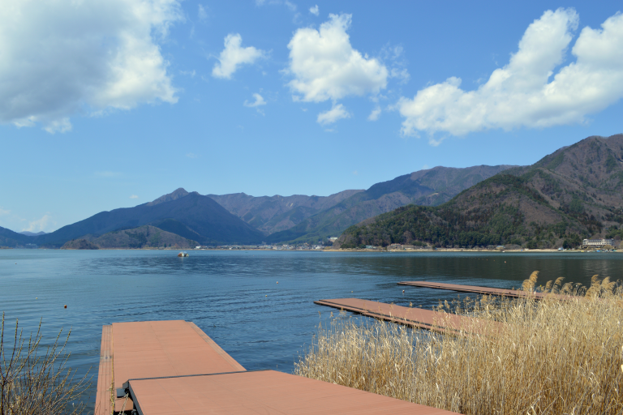

# `vpxc`

[](https://github.com/psspssr/vpxc/actions/workflows/ci.yml)
[](./LICENSE)
[](./cpp)
[](./pyproject.toml)

`vpxc` is a lossless image and 3D medical volume compressor written in C++20 (`AVX2` / `ARM64 NEON` integer SIMD) with Python bindings and a CLI.

It supports 8-bit and 16-bit 2D images (`.vpxc`), 8/16-bit signed and unsigned 3D CT/MRI stacks with millisecond single-slice random access (`.vpxv`), and `SHA-256` byte-exact DICOM Part 10 archives (`.vpxd`).

- **Plain-English explainer:** [`docs/how-it-works.md`](./docs/how-it-works.md)
- **C++20 internals & module map:** [`docs/architecture.md`](./docs/architecture.md)

---

## Highlights

- **3D Clinical CT & MRI (`VPXV` / `VPXD`):** `24.9%` smaller than lossless `JPEG 2000 (5/3)` (`HTJ2K`), `16.6%` smaller than `JPEG-LS`, `43.6%` smaller than `.nii.gz`, and `5.0%` smaller than `JPEG XL (-e 9)` on held-out 16-bit signed HU CT stacks, with **`0.5–3.2 ms` random-access slice seeking**.
- **2D Lossless Photos (`-e 1 .. -e 3`):** Smaller than `JPEG XL (-e 9)`, `WebP Lossless`, `JPEG 2000`, `JPEG-LS`, and `PNG` on held-out `TEST_CLIC` and `Kodak` suites (`~90–113 ms/img` at default `-e 1`).
- **Real-Time Fast Mode (`-e 0`):** Decodes `768×512` RGB24 images in **`7.3 ms`** (`6.6 ms` encode) and 3D CT volumes at **`> 320 MB/s`**.
- **Deterministic & Fuzz-Tested:** Zero floating-point instructions in all decode paths (verified via `objdump` in CI across `x86_64` and `ARM64`), `CRC-32` / `SHA-256` integrity checks, and `libFuzzer + ASan + UBSan` testing.

---

## Benchmarks (Held-Out Test Suites)

All results measure serialized file bytes verified bit-exact (`np.array_equal(decoded, original)`), with zero train/test overlap (`SHA-256` and perceptual-hash checked).

### 1. 16-Bit Clinical CT Volumes (`57.09 MB` Raw, `672` Axial Slices Across 3 Scans)

| Codec | Total Size | Bits/Voxel | Ratio | Encode (`ms`) | Decode (`ms`) | Random Slice Seek |
| :--- | ---: | ---: | ---: | ---: | ---: | :---: |
| **`vpxc 3D (-e 2, GoS=8)`** | **11,628,495 B** | **3.2588** | **4.91x** | **4,917** | **1,132** | **`~2.6–7.0 ms`** |
| **`vpxc 3D (-e 1, GoS=8)`** | **11,643,004 B** | **3.2629** | **4.90x** | **1,480** | **1,101** | **`~2.6–7.0 ms`** |
| `JPEG XL (-d 0 -e 9) (2D)` | 12,244,395 B | 3.4314 | 4.66x | 37,088 | 1,769 | Yes |
| **`vpxc 3D (-e 0, fast, GoS=8)`** | **12,627,015 B** | **3.5386** | **4.52x** | **201** | **178** | **`0.5–2.5 ms`** |
| `JPEG-LS (CharLS 2D)` | 13,943,945 B | 3.9077 | 4.09x | 378 | 356 | Yes |
| `JPEG 2000 (5/3, OpenJPEG 2D)` | 15,474,346 B | 4.3366 | 3.69x | 2,638 | 2,406 | Yes |
| `PNG (level 9, 2D)` | 19,568,255 B | 5.4839 | 2.92x | 2,632 | 256 | Yes |
| `NIfTI (.nii.gz, gzip)` | 20,633,262 B | 5.7824 | 2.77x | — | — | No (full stream) |

<details>
<summary><b>Per-volume clinical breakdown (Abdominal CT, Head/Neck CT, Neurosurgical CT, 3D Brain MRI, DICOM)</b></summary>

<br />

| Dataset | Shape & Type | Raw | `.nii.gz` | `JPEG 2000` | `JPEG-LS` | `JPEG XL (-e 9)` | **`vpxc 3D (-e 0)`** | **`vpxc 3D (-e 1/-e 2)`** |
| :--- | :--- | ---: | ---: | ---: | ---: | ---: | ---: | ---: |
| `CT_Abdo` | `256×178×255` `int16` | `23.24 MB` | `7.75 MB` | `5.62 MB` | `5.07 MB` | `4.38 MB` | **`4.43 MB`** | **`4.06 MB` (`5.72x`)** |
| `CT_Philips` | `256×232×185` `int16` | `21.98 MB` | `7.82 MB` | `5.04 MB` | `4.88 MB` | `4.03 MB` | **`4.23 MB`** | **`3.62 MB` (`6.07x`)** |
| `CT_Electrodes` | `160×232×160` `int16` | `11.88 MB` | `5.06 MB` | `4.82 MB` | `4.00 MB` | `3.84 MB` | **`3.97 MB`** | **`3.95 MB` (`3.01x`)** |
| `chris_t1` (MRI) | `190×256×188` `uint8` | `9.14 MB` | `4.18 MB` | `3.66 MB` | `3.33 MB` | `3.09 MB` | **`3.28 MB`** | **`2.93 MB` (`3.12x`)** |
| `DICOM` (`VPXD`) | `256×178×255` `.dcm` | `23.24 MB` | — | — | — | — | **`4.43 MB`** | **`4.08 MB` (`SHA-256` exact)** |

</details>

### 2. `TEST_CLIC` Photographs (24 Held-Out Images, `768×512` RGB24)

*(Raw RGB24 = `8.00 bpsp` / `24.00 bpp`.)*

| Codec | Rate (`bpsp`) | Rate (`bpp`) | Ratio | Encode (`ms/img`) | Decode (`ms/img`) |
| :--- | ---: | ---: | ---: | ---: | ---: |
| **`vpxc (-e 3, tile=768)`** | **2.7906** | **8.3718** | **2.87x** | **1,193.4** | **241.6** |
| **`vpxc (-e 2, tile=384)`** | **2.8070** | **8.4210** | **2.85x** | **331.0** | **99.9** |
| **`vpxc (-e 1, default)`** | **2.8215** | **8.4645** | **2.84x** | **112.9** | **99.6** |
| `JPEG XL (-d 0 -e 9)` | 2.8651 | 8.5953 | 2.79x | 1,247.9 | 84.3 |
| `JPEG XL (-d 0 -e 7)` | 2.9040 | 8.7120 | 2.75x | 400.6 | 83.5 |
| `WebP-L (lossless)` | 3.2021 | 9.6063 | 2.50x | 157.5 | 7.1 |
| `JPEG 2000 (5/3)` | 3.2187 | 9.6561 | 2.49x | 75.1 | 66.0 |
| `JPEG-LS` | 4.2744 | 12.8232 | 1.87x | 19.5 | 15.1 |
| `PNG (level 9)` | 4.3926 | 13.1778 | 1.82x | 106.2 | 5.3 |

### 3. Kodak Lossless Suite (24 Photographs, `768×512` / `512×768` RGB24)

| Codec | Rate (`bpsp`) | Rate (`bpp`) | Ratio | Encode (`ms/img`) | Decode (`ms/img`) |
| :--- | ---: | ---: | ---: | ---: | ---: |
| **`vpxc (-e 3, tile=768)`** | **2.8227** | **8.4681** | **2.83x** | **1,139.0** | **225.0** |
| `JPEG XL (-d 0 -e 9)` | 2.8284 | 8.4851 | 2.83x | 1,318.5 | 94.5 |
| **`vpxc (-e 2, tile=384)`** | **2.8794** | **8.6382** | **2.78x** | **322.3** | **98.2** |
| **`vpxc (-e 1, default)`** | **2.9046** | **8.7138** | **2.75x** | **104.4** | **94.1** |
| `JPEG 2000 (5/3)` | 3.1921 | 9.5762 | 2.51x | 74.2 | 65.4 |
| `WebP-L (lossless)` | 3.2033 | 9.6099 | 2.50x | 168.2 | 6.9 |
| **`vpxc (-e 0, fast)`** | **3.2588** | **9.7764** | **2.45x** | **6.6** | **7.3** |
| `JPEG-LS` | 4.3577 | 13.0731 | 1.84x | 19.4 | 15.0 |
| `PNG (level 9)` | 4.4047 | 13.2142 | 1.82x | 90.7 | 5.2 |

---

## Visual Round-Trip Example (`CC0 1.0`)

<table>
  <tr>
    <th width="50%">Original RGB24 (<code>1,179,648 B</code> raw &middot; <code>626,407 B</code> PNG)</th>
    <th width="50%"><code>vpxc -e 1</code> (<code>451,715 B</code>, <code>-27.9%</code> vs PNG, bit-identical)</th>
  </tr>
  <tr>
    <td width="50%" align="center">
      
    </td>
    <td width="50%" align="center">
      
    </td>
  </tr>
</table>

*Photo: [Lake Kawaguchi jetties with Mount Setto](https://commons.wikimedia.org/wiki/File:Kawaguchiko_rowing_center_jetties_on_Lake_Kawaguchi,_with_Mount_Setto_in_the_background,_Fujikawaguchiko,_2016.jpg) (CC0 1.0 Public Domain).*

---

## Installation

```bash
# 1. Build C++20 native library
cmake -S cpp -B cpp/build -DCMAKE_BUILD_TYPE=Release
cmake --build cpp/build -j

# 2. Install Python package & CLI (add ".[bench]" for external codec benchmarking)
pip install -e ".[images]"
```

---

## Quickstart

### CLI

```bash
# 2D images (--effort 0 for <8ms fast mode, --effort 1..3 for smaller files)
vpxc encode photo.png photo.vpxc --effort 1
vpxc decode photo.vpxc restored.png
vpxc roundtrip photo.png

# 3D volumes (.npy <-> .vpxv) & single-slice random access
vpxc encode-volume ct_hu.npy ct_hu.vpxv --effort 1 --gos 8
vpxc inspect-volume ct_hu.vpxv
vpxc decode-volume ct_hu.vpxv slice_73.npy --slice 73

# Byte-exact DICOM Part 10 (.dcm <-> .vpxd, SHA-256 verified)
vpxc pack-dicom scan.dcm scan.vpxd --effort 1 --gos 8
vpxc unpack-dicom scan.vpxd restored.dcm
```

### Python

```python
import numpy as np
from vpxc import decode, decode_slice, decode_volume, encode, encode_volume, pack_dicom, unpack_dicom

# 2D image
img = np.random.default_rng(0).integers(0, 256, size=(512, 768, 3), dtype=np.uint8)
blob = encode(img, effort=1)
assert np.array_equal(decode(blob), img)

# 3D signed 16-bit Hounsfield Unit CT volume + O(1) single-slice seek
ct = np.random.default_rng(1).integers(-1024, 2000, size=(64, 256, 256), dtype=np.int16)
vblob = encode_volume(ct, effort=0, gos_size=8)
assert np.array_equal(decode_slice(vblob, 42), ct[42])
assert np.array_equal(decode_volume(vblob), ct)
```

### Effort Levels

| Flag | Mode | Typical Speed & Use Case |
| :--- | :--- | :--- |
| `--effort 0` | Fast | `~7 ms` per 2D image / `> 320 MB/s` 3D CT decode (`0.5–2.5 ms` slice seek). |
| `--effort 1` | Default | `~100 ms` per 2D image / `~2.2 ms` per CT slice. Beats `JPEG XL -e 9` on `TEST_CLIC` and 3D CT. |
| `--effort 2` | Balanced | `~320 ms` per 2D image. Adds per-tile regularized weight fitting and context-tree splits. |
| `--effort 3` | Max | `~805–1,190 ms` per 2D image. Full tile optimization (`--tile 768` for max compression). |

---

## Testing & Fuzzing

```bash
# Unit, differential, SIMD, & zero-float disassembly tests
PYTHONPATH=src python3 -m unittest discover -s tests -v

# Clang libFuzzer + ASan + UBSan decoder harness
cmake -S cpp -B cpp/build-fuzz -DCMAKE_CXX_COMPILER=clang++ -DVPXC_BUILD_FUZZER=ON
cmake --build cpp/build-fuzz --target vpxc_fuzz_decode -j
./cpp/build-fuzz/vpxc_fuzz_decode -runs=250000 -rss_limit_mb=512
```

---

## Documentation & License

- [`docs/how-it-works.md`](./docs/how-it-works.md) — Plain-English walkthrough of how `vpxc` predicts pixels, encodes residuals, and seeks 3D slices.
- [`docs/architecture.md`](./docs/architecture.md) — C++20 module layout, SIMD kernels, container invariants, and training scripts ([`training/`](./training/)).
- Released under the [MIT License](./LICENSE).
