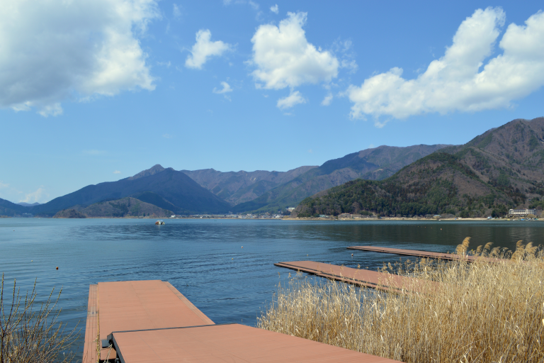

# `vpxc` — Deterministic Lossless Medical & Photographic Image Compression

[](https://github.com/psspssr/vpxc/actions/workflows/ci.yml)
[](./LICENSE)
[](./cpp)
[](./pyproject.toml)

`vpxc` is an open-source **lossless image and 3D clinical volume codec** (native C++20 engine with portable `x86_64 AVX2` & `ARM64 NEON` integer SIMD, Python bindings, and CLI) for **12/16-bit signed/unsigned 3D CT & MRI stacks (`VPXV`)**, **byte-exact DICOM Part 10 archives (`VPXD`)**, and 8-bit/16-bit grayscale, RGB, and RGBA images (`.vpxc`).

Most lossless codecs force an infrastructure compromise: fast codecs leave 15–35% of storage on the table (`JPEG 2000` / `HTJ2K`, `JPEG-LS`, `PNG`), stream compressors destroy random slice access (`.nii.gz`), and high-ratio codecs require multi-second CPU encoding (`JPEG XL -e 9`) or non-deterministic GPUs. **`vpxc` closes all three gaps on pure CPU:**

- **Clinical 12/16-Bit & 3D Volumetric CT/MRI (`VPXV` + `VPXD`):** Compresses held-out 16-bit signed Hounsfield Unit CT stacks **`24.9%` smaller than `JPEG 2000 (5/3)` (`HTJ2K`)**, **`16.6%` smaller than `JPEG-LS`**, **`43.6%` smaller than `.nii.gz`**, and **`5.0%` smaller than `JPEG XL (-e 9)`** (`25x` faster encode), while preserving **`0.5–3.2 ms` $O(1)$ random-access single-slice decoding** and **cryptographic `SHA-256` byte-exact `.dcm` restoration**.
- **Sub-10ms Real-Time Fast Profile (`-e 0` / `--profile fast`):** 4-way lockstep 12-bit flat-LUT `rANS` + decoupled MED / 3D Delta-MED decodes `768×512` RGB24 images in **`7.3 ms`** (`6.6 ms` encode) and full 672-slice 16-bit CT stacks at **`> 320 MB/s`**.
- **State-of-the-Art 2D Lossless Photography (`-e 1 .. -e 3`):** Smaller than `JPEG XL (-e 9)`, `WebP Lossless`, `JPEG 2000`, and `PNG` on held-out `4:4:4` photographic benchmarks at **`~90–113 ms` default encode (`-e 1`)** (`11–12x` faster than `JPEG XL -e 9`).
- **100% IEEE-754-Free & Fuzz-Hardened C++20 Decoder:** Every decode path (`frontier`, `fast`, and `VPXV` 3D medical) compiles to **zero floating-point instructions** (verified via `objdump` disassembly in CI across `x86_64` and `ARM64`), enforces pre-allocation zip-bomb caps + per-slice and whole-volume `CRC-32`, and passes **350,000+ `libFuzzer + ASan + UBSan` runs** with zero errors.

---

## Performance & Held-Out Benchmark Suites

### Evaluation Protocol

Universal `frontier` priors (`cpp/include/vpxc/frontier_priors.hpp`, ~5.5 KB of integer tables) were trained offline (`training/prepare_corpora.py`, `training/train_frontier.cpp`) using **8-fold image-grouped cross-validation** and **James-Stein $t$-statistic shrinkage**, verified via exact SHA-256 and $16 \times 16$ perceptual distance to have **zero overlap** with any held-out medical or photographic test suite below.

Every number below measures **actual serialized container bytes** verified bit-for-bit (`np.array_equal(decoded, original)`), running in-process on the same CPU (`vpxc` C++20 native library vs. `OpenJPEG`, `CharLS`, `libjxl`, `libwebp`, and `libpng` via `imagecodecs`).

---

### 1. Held-Out Clinical Medical Imaging (`16-Bit Signed HU CT`, `3D Brain MRI` & `DICOM`)

`vpxc` provides a dedicated 3D volumetric container (**`VPXV`**, `cpp/src/medical.cpp`) and zero-dependency **DICOM Part 10 byte-exact archive wrapper** (**`VPXD`**, `src/vpxc/medical.py`) designed for PACS archives, teleradiology viewers, and medical AI pipelines:

- **Native Signed `int16` Hounsfield Units (`-1024 .. +3071+` HU), `uint16`, & `uint8`:** Dynamic per-slice `[gmin, gmax, step_gcd]` compaction, 5-byte air/padding slice bypass, 1-byte duplicate-slice bypass, and adaptive `qsh` soft-tissue bilateral scaling.
- **3D Causal Inter-Slice Prediction with $O(1)$ Slice Random Access:** Slices are grouped into independent **Groups of Slices (`GoS`, default `8`)** with a byte-offset directory and per-slice `CRC-32`. Archival modes (`-e 1, 2`) predict $\Delta_z S = S_z - S_{z-1}$ conditioned on $S_{z-1}$ spatial derivatives ($\partial_x, \partial_y, \nabla^2$, absorbing gantry tilt and respiratory drift) plus causal $Z$-velocity ($S_{z-1} - S_{z-2}$); `-e 0` uses 3D anatomy-switched Delta-MED + 4-way LUT `rANS` for sub-3ms PACS slice scrubbing.
- **Cryptographic Byte-Exact `.dcm` Restoration (`VPXD`):** Compresses Explicit/Implicit VR Little Endian DICOM pixel data via `vpxc` and non-pixel tags via `zlib`, verifying unpacked `.dcm` files against an embedded **32-byte `SHA-256` digest**.

#### Aggregate Held-Out 16-Bit Clinical CT Suite (`57.09 MB` Raw, `672` Axial Slices Across 3 Clinical Volumes)

*(External 2D codecs are steelmanned with optimal unsigned `-vol.min()` bias shifting where signed `int16` is unsupported, plus per-slice framing, and verified 100% bit-exact.)*

| Codec | Total Size | Bits/Voxel (`bpv`) | Ratio vs. Raw | Total Encode (`ms`) | Total Decode (`ms`) | Random-Access Slice Seek |
| :--- | ---: | ---: | ---: | ---: | ---: | :---: |
| **`vpxc 3D (-e 2, GoS=8)`** | **11,628,495 B** | **3.2588** | **4.91x** | **4,917** | **1,132** | **`~2.6–7.0 ms`** |
| **`vpxc 3D (-e 1, GoS=8)`** | **11,643,004 B** | **3.2629** | **4.90x** | **1,480** | **1,101** | **`~2.6–7.0 ms`** |
| `JPEG XL (-d 0 -e 9) (2D)` | 12,244,395 B | 3.4314 | 4.66x | 37,088 | 1,769 | Yes |
| `JPEG XL (-d 0 -e 7) (2D)` | 12,491,934 B | 3.5008 | 4.57x | 9,371 | 1,731 | Yes |
| **`vpxc 3D (-e 0, fast, GoS=8)`** | **12,627,015 B** | **3.5386** | **4.52x** | **201** | **178** | **`0.5–2.5 ms`** |
| **`vpxc 2D (-e 1)`** | **13,015,146 B** | **3.6474** | **4.39x** | **4,560** | **4,481** | Yes |
| `JPEG XL (-d 0 -e 3) (2D)` | 13,576,792 B | 3.8048 | 4.21x | 1,379 | 939 | Yes |
| **`vpxc 2D (-e 0, fast)`** | **13,933,562 B** | **3.9048** | **4.10x** | **314** | **381** | **`< 0.6 ms`** |
| `JPEG-LS (CharLS 2D)` | 13,943,945 B | 3.9077 | 4.09x | 378 | 356 | Yes |
| `JPEG 2000 (5/3, OpenJPEG 2D)` | 15,474,346 B | 4.3366 | 3.69x | 2,638 | 2,406 | Yes |
| `PNG (level 9, 2D)` | 19,568,255 B | 5.4839 | 2.92x | 2,632 | 256 | Yes |
| `NIfTI (.nii.gz, gzip)` | 20,633,262 B | 5.7824 | 2.77x | — | — | No (full stream) |

#### Per-Modality Clinical Volume & DICOM Breakdown

| Clinical Dataset | Dimensions & Type | Raw Size | `.nii.gz` | `JPEG 2000 (5/3)` | `JPEG-LS` | `JPEG XL (-e 9)` | **`vpxc 3D (-e 0)`** | **`vpxc 3D (-e 1 / -e 2)`** |
| :--- | :--- | ---: | ---: | ---: | ---: | ---: | ---: | ---: |
| **Abdominal CT** (`CT_Abdo`) | `256×178×255` `int16` (`-1024..3302` HU) | `23.24 MB` | `7.75 MB` | `5.62 MB` (`3.87 bpv`) | `5.07 MB` (`3.49 bpv`) | `4.38 MB` (`3.01 bpv`) | **`4.43 MB`** (`84 ms` enc) | **`4.06 MB` (`2.80 bpv`, `5.72x`)** |
| **Head/Neck CT** (`CT_Philips`) | `256×232×185` `int16` (`0..3833` HU) | `21.98 MB` | `7.82 MB` | `5.04 MB` (`3.67 bpv`) | `4.88 MB` (`3.55 bpv`) | `4.03 MB` (`2.93 bpv`) | **`4.23 MB`** (`72 ms` enc) | **`3.62 MB` (`2.63 bpv`, `6.07x`)** |
| **Neurosurgical CT** (`CT_Electrodes`) | `160×232×160` `int16` (`-10670..32767`) | `11.88 MB` | `5.06 MB` | `4.82 MB` (`6.50 bpv`) | `4.00 MB` (`5.38 bpv`) | `3.84 MB` (`5.18 bpv`) | **`3.97 MB`** (`41 ms` enc) | **`3.95 MB` (`5.32 bpv`, `3.01x`)** |
| **3D T1 Brain MRI** (`chris_t1`) | `190×256×188` `uint8` (`0..255`) | `9.14 MB` | `4.18 MB` | `3.66 MB` (`3.21 bpv`) | `3.33 MB` (`2.91 bpv`) | `3.09 MB` (`2.70 bpv`) | **`3.28 MB`** (`73 ms` enc) | **`2.93 MB` (`2.56 bpv`, `3.12x`)** |
| **Multi-Frame CT DICOM** (`VPXD`) | `256×178×255` `.dcm` (`SHA-256` exact) | `23.24 MB` | — | — | — | — | **`4.43 MB`** | **`4.08 MB` (`5.70x`, byte-exact `.dcm`)** |

---

### 2. Held-Out Modern `4:4:4` Photography (`TEST_CLIC`, 24 Disjoint Photographs, `768×512` RGB24)

*(Rates in **`bpsp`** = bits per channel sample, raw RGB24 = `8.00 bpsp`; **`bpp`** = bits per pixel, raw RGB24 = `24.00 bpp`.)*

| Codec | Rate (`bpsp`) | Rate (`bpp`) | Ratio | Encode (`ms/img`) | Decode (`ms/img`) |
| :--- | ---: | ---: | ---: | ---: | ---: |
| **`vpxc (-e 3, tile=768)`** | **2.7906** | **8.3718** | **2.87x** | **1,193.4** | **241.6** |
| **`vpxc (-e 3, tile=384)`** | **2.7962** | **8.3886** | **2.86x** | **808.1** | **96.5** |
| **`vpxc (-e 2, tile=384)`** | **2.8070** | **8.4210** | **2.85x** | **331.0** | **99.9** |
| **`vpxc (-e 1, default 384)`** | **2.8215** | **8.4645** | **2.84x** | **112.9** | **99.6** |
| **`vpxc (-e 1, tile=256)`** | **2.8262** | **8.4786** | **2.83x** | **99.6** | **85.0** |
| `JPEG XL (-d 0 -e 9)` | 2.8651 | 8.5953 | 2.79x | 1,247.9 | 84.3 |
| `JPEG XL (-d 0 -e 7)` | 2.9040 | 8.7120 | 2.75x | 400.6 | 83.5 |
| `JPEG XL (-d 0 -e 5)` | 2.9555 | 8.8665 | 2.71x | 204.6 | 71.9 |
| `JPEG XL (-d 0 -e 3)` | 3.0388 | 9.1164 | 2.63x | 45.0 | 32.4 |
| `WebP-L (lossless)` | 3.2021 | 9.6063 | 2.50x | 157.5 | 7.1 |
| `JPEG 2000 (5/3)` | 3.2187 | 9.6561 | 2.49x | 75.1 | 66.0 |
| `JPEG-LS` | 4.2744 | 12.8232 | 1.87x | 19.5 | 15.1 |
| `PNG (level 9)` | 4.3926 | 13.1778 | 1.82x | 106.2 | 5.3 |

---

### 3. Held-Out Classic Kodak Suite (All 24 Photographs, `768×512` / `512×768` RGB24)

| Codec | Rate (`bpsp`) | Rate (`bpp`) | Ratio | Encode (`ms/img`) | Decode (`ms/img`) |
| :--- | ---: | ---: | ---: | ---: | ---: |
| **`vpxc (-e 3, tile=768)`** | **2.8227** | **8.4681** | **2.83x** | **1,139.0** | **225.0** |
| `JPEG XL (-d 0 -e 9)` | 2.8284 | 8.4851 | 2.83x | 1,318.5 | 94.5 |
| **`vpxc (-e 3, tile=384)`** | **2.8515** | **8.5545** | **2.81x** | **805.3** | **90.5** |
| `JPEG XL (-d 0 -e 7)` | 2.8630 | 8.5890 | 2.79x | 435.7 | 91.3 |
| **`vpxc (-e 2, tile=384)`** | **2.8794** | **8.6382** | **2.78x** | **322.3** | **98.2** |
| **`vpxc (-e 1, default 384)`** | **2.9046** | **8.7138** | **2.75x** | **104.4** | **94.1** |
| **`vpxc (-e 1, tile=256)`** | **2.9173** | **8.7519** | **2.74x** | **89.6** | **84.4** |
| `JPEG XL (-d 0 -e 5)` | 3.0534 | 9.1602 | 2.62x | 202.6 | 76.0 |
| `JPEG XL (-d 0 -e 3)` | 3.1461 | 9.4383 | 2.54x | 46.0 | 32.7 |
| `JPEG 2000 (5/3)` | 3.1921 | 9.5762 | 2.51x | 74.2 | 65.4 |
| `WebP-L (lossless)` | 3.2033 | 9.6099 | 2.50x | 168.2 | 6.9 |
| **`vpxc (-e 0, fast)`** | **3.2588** | **9.7764** | **2.45x** | **6.6** | **7.3** |
| `JPEG-LS` | 4.3577 | 13.0731 | 1.84x | 19.4 | 15.0 |
| `PNG (level 9)` | 4.4047 | 13.2142 | 1.82x | 90.7 | 5.2 |

---

## Side-by-Side Visual Verification (`CC0 1.0 Public Domain`)

<table>
  <tr>
    <th width="50%">Uncompressed Source (<code>1,179,648 bytes</code> raw RGB24)</th>
    <th width="50%">Compressed with <code>vpxc -e 1</code> (<code>451,715 bytes</code>) &amp; Restored</th>
  </tr>
  <tr>
    <td width="50%" align="center">
      
    </td>
    <td width="50%" align="center">
      
    </td>
  </tr>
  <tr>
    <td valign="top">
      <ul>
        <li><b>Format:</b> Raw 8-bit RGB24 (<code>768 &times; 512</code>)</li>
        <li><b>Uncompressed size:</b> <code>1,179,648 bytes</code> (<code>8.00 bpsp</code>)</li>
        <li><b>Optimized PNG (<code>level 9</code>):</b> <code>626,407 bytes</code> (<code>174.3 ms</code> enc)</li>
        <li><b>Pixel SHA-256:</b> <code>e06e6c5a06cf09a5...</code></li>
      </ul>
    </td>
    <td valign="top">
      <ul>
        <li><b><code>.vpxc</code> size (<code>-e 1</code>):</b> <b><code>451,715 bytes</code></b> (<b><code>3.06 bpsp</code></b>, <b><code>2.61&times;</code></b> ratio)</li>
        <li><b>Savings:</b> <b><code>-61.7%</code></b> vs. raw &middot; <b><code>-27.9%</code></b> vs. PNG &middot; <b><code>-3.8%</code></b> vs. JPEG XL (<code>-e 9</code>)</li>
        <li><b>Speed:</b> <b><code>102.7 ms</code></b> encode &middot; <b><code>95.9 ms</code></b> decode (or <b><code>7.6 ms</code></b> in <code>-e 0</code> fast mode)</li>
        <li><b>Quality loss:</b> <b>Zero</b> (<code>Max Error = 0</code>, <code>PSNR = &infin;</code>, identical SHA-256 <code>e06e6c5a06cf09a5...</code>)</li>
      </ul>
    </td>
  </tr>
</table>

<details>
<summary><b>All codecs on this photograph (<code>Lake Kawaguchi</code>, <code>768&times;512</code> RGB24 — CC0 1.0 Public Domain)</b></summary>

<br />

| Codec | Compressed Size | Rate (`bpsp`) | Ratio vs. Raw | Encode (`ms`) | Decode (`ms`) | Exact Lossless |
| :--- | ---: | ---: | ---: | ---: | ---: | :---: |
| **`vpxc (-e 2)`** | **449,076 B** | **3.0455** | **2.63x** | **356.6** | **97.0** | Yes |
| **`vpxc (-e 3)`** | **449,966 B** | **3.0515** | **2.62x** | **849.8** | **86.7** | Yes |
| **`vpxc (-e 1, default)`** | **451,715 B** | **3.0634** | **2.61x** | **102.7** | **95.9** | Yes |
| `JPEG XL (-d 0 -e 9)` | 469,714 B | 3.1855 | 2.51x | 1,231.9 | 84.1 | Yes |
| `JPEG XL (-d 0 -e 7)` | 478,636 B | 3.2460 | 2.46x | 401.4 | 86.2 | Yes |
| `WebP-L (lossless)` | 486,162 B | 3.2970 | 2.43x | 154.6 | 6.8 | Yes |
| `JPEG XL (-d 0 -e 3)` | 494,497 B | 3.3535 | 2.39x | 47.1 | 32.5 | Yes |
| `JPEG 2000 (5/3)` | 510,727 B | 3.4636 | 2.31x | 80.3 | 70.3 | Yes |
| **`vpxc (-e 0, fast)`** | **522,671 B** | **3.5446** | **2.26x** | **7.6** | **7.6** | Yes |
| `JPEG-LS` | 528,110 B | 3.5815 | 2.23x | 19.2 | 15.2 | Yes |
| `PNG (level 9)` | 626,407 B | 4.2481 | 1.88x | 174.3 | 5.3 | Yes |

*Image credit: [Lake Kawaguchi jetties with Mount Setto in the background](https://commons.wikimedia.org/wiki/File:Kawaguchiko_rowing_center_jetties_on_Lake_Kawaguchi,_with_Mount_Setto_in_the_background,_Fujikawaguchiko,_2016.jpg) via Wikimedia Commons, dedicated to the public domain under [CC0 1.0 Universal](https://creativecommons.org/publicdomain/zero/1.0/).*

</details>

---

## Installation

### 1. Build the C++20 Native Engine (Recommended)

Building `cpp/build/libvpxc_native.so` enables the multi-threaded C++20 `VPXV` medical engine, `frontier` coder, 4-way LUT `rANS` `fast` coder, and `x86_64 AVX2` / `ARM64 NEON` integer SIMD kernels:

```bash
cmake -S cpp -B cpp/build -DCMAKE_BUILD_TYPE=Release
cmake --build cpp/build -j
```

### 2. Install the Python Package & CLI

```bash
# Core NumPy + Medical Volume + Byte-Exact DICOM API & CLI:
pip install -e .

# With standard 2D image file I/O (PNG, TIFF, WebP, BMP, JPEG):
pip install -e ".[images]"

# With reference codecs (JPEG XL, WebP-L, JPEG 2000, JPEG-LS, PNG, QOI) for benchmarking:
pip install -e ".[bench]"
```

When `cpp/build/libvpxc_native.so` is present, `vpxc` automatically dispatches to C++20 (`VPXC_PYTHON=1` forces the pure-Python 2D reference path).

---

## Quickstart

### Command Line

```bash
# Losslessly pack & restore a byte-exact clinical DICOM (.dcm <-> .vpxd, SHA-256 verified):
vpxc pack-dicom scan.dcm scan.vpxd --effort 1 --gos 8
vpxc unpack-dicom scan.vpxd restored_scan.dcm

# Compress, inspect, or seek a single axial slice from a 3D CT/MRI volume (.npy <-> .vpxv):
vpxc encode-volume ct_hu.npy ct_hu.vpxv --effort 1 --gos 8
vpxc inspect-volume ct_hu.vpxv
vpxc decode-volume ct_hu.vpxv slice_73.npy --slice 73

# Real-time ultra-fast 2D encode & decode (< 8 ms on 768x512 RGB24, effort 0):
vpxc encode photo.png photo_fast.vpxc --effort 0

# Fast archival 2D encode (~100 ms default, effort 1):
vpxc encode photo.png photo.vpxc

# Maximum archival 2D compression (effort 3):
vpxc encode photo.png photo.vpxc --effort 3 --tile 768

# Decode, round-trip verify, or benchmark against JP2K / JPEG-LS / JXL / WebP-L / PNG:
vpxc decode photo.vpxc restored.png
vpxc roundtrip photo.png
vpxc benchmark photo.png --markdown
```

### Python API

```python
import hashlib
import numpy as np
from vpxc import (
    benchmark_image,
    benchmark_volume,
    create_multiframe_dicom,
    decode,
    decode_dicom_pixels,
    decode_slice,
    decode_volume,
    encode,
    encode_volume,
    format_benchmark_table,
    inspect_volume,
    pack_dicom,
    unpack_dicom,
)

# 1. 3D Volumetric 16-Bit Signed Hounsfield Unit CT / MRI with O(1) Slice Seeking
ct_hu = np.random.default_rng(1).integers(-1024, 2000, size=(128, 256, 256), dtype=np.int16)
vol_blob = encode_volume(ct_hu, effort=0, gos_size=8)  # Real-time PACS fast mode (-e 1..2 for archival)
meta = inspect_volume(vol_blob)                        # {'depth': 128, 'height': 256, 'width': 256, 'dtype': 'int16', ...}
slice_73 = decode_slice(vol_blob, 73)                  # Millisecond O(1) GoS slice seek + per-slice CRC-32
assert np.array_equal(slice_73, ct_hu[73])
assert np.array_equal(decode_volume(vol_blob), ct_hu)

# 2. Byte-Exact DICOM Part 10 Archive Wrapper (VPXD, SHA-256 verified)
dcm_bytes = create_multiframe_dicom(ct_hu[:8], modality="CT")
vpxd_blob = pack_dicom(dcm_bytes, effort=1, gos_size=4)
restored_dcm = unpack_dicom(vpxd_blob)
assert hashlib.sha256(restored_dcm).digest() == hashlib.sha256(dcm_bytes).digest()
assert np.array_equal(decode_dicom_pixels(vpxd_blob, z_index=5), ct_hu[5])

# 3. 2D Photographic / Grayscale Images (effort=0 for <10ms decode, effort=1..3 for frontier)
image = np.random.default_rng(0).integers(0, 256, size=(512, 768, 3), dtype=np.uint8)
blob = encode(image, effort=1)
assert np.array_equal(decode(blob), image)
```

### Effort Presets & Options

| Option | Values | Default | When to Use |
| :--- | :--- | :---: | :--- |
| `--effort 0` | Real-Time Fast | — | **`~6.6 ms` enc / `7.3 ms` dec** (`768×512` RGB24) or **`> 320 MB/s`** 3D CT decode (`0.5–2.5 ms` random slice seek). 4-way lockstep 12-bit flat-LUT `rANS` + MED / 3D Delta-MED. |
| `--effort 1` | Fast Archival | **Default** | **`~90–113 ms/img`** (2D) or **`~2.2 ms/slice`** (3D CT). Single-pass cross-validated prior + causal integer `NLMS` + Universal `MA` tree. Beats `JPEG XL -e 9` on `4:4:4` photos and 3D CT/MRI. |
| `--effort 2` | Balanced Archival | — | **`~320 ms/img`**. Adds FPE-regularized subsampled MAP Ridge adaptation and `O(1)` hybrid linear-log histogram `MA` context-tree splitting. |
| `--effort 3` | Max Archival | — | **`~805–1,190 ms/img`**. Full-tile MAP Ridge + exhaustive reversible color transform and $2\times 2$ chroma coset search. |
| `--gos` | `1 .. 64` | `8` | 3D medical Group-of-Slices interval (`1` = pure intra-slice random access; `8` = `87.5%` 3D P-slices with millisecond slice seek). |
| `--tile` | `8 .. 4096` | `384` | 2D tile size in pixels. Controls multi-threaded tile parallelism and caps per-thread L1/L2 working memory. |

---

## Architecture Overview

1. **`VPXV` 3D Volumetric Medical Engine & `VPXD` DICOM Wrapper (`cpp/src/medical.cpp`, `src/vpxc/medical.py`):** Maps signed `int16` Hounsfield Units bijectively (`v ^ 0x8000`) with per-slice `[gmin, gmax, step_gcd]` compaction, partitions axial stacks into parallel `GoS` blocks with per-slice `CRC-32`, and adaptively selects per slice between 2D/3D `fast` and 2D/3D `frontier` (plus raw incompressible bypass).
2. **`frontier` High-Ratio Integer Codec (`cpp/src/frontier.cpp`, `cpp/src/entropy.cpp`):** Combines reversible color transforms (`Subtract-Green`, `Subtract-Average`), an 8-expert Weighted Predictor (`WP8`), LRU-2 `PatchPredictor`, 36-tap `Q8` directional linear predictors (`AVX2` / `ARM64 NEON` `dot36_i32_i16`), division-free integer `NLMS`, anti-overfitting `MA` trees, and 64-bit reciprocal Student-$t$ `Core66 rANS`.
3. **`fast` Sub-10ms Throughput Codec (`cpp/src/fast_codec.cpp`, `cpp/include/vpxc/simd.hpp`):** Pairs SIMD inverse color transforms and 4-stripe row-decoupled MED / 3D anatomy-switched Delta-MED with a 4-way interleaved 12-bit flat-LUT `rANS` decoder (`16 KB` L1 table, single-branch 16-bit renormalization, 64-bit bulk bit-reader).
4. **Determinism & Security Hardening (`cpp/fuzz/fuzz_decode.cpp`):** Strict pre-allocation geometry/directory validation prevents header-amplification zip-bombs; all decode object files contain **zero floating-point instructions**; continuously validated under `libFuzzer + AddressSanitizer + UndefinedBehaviorSanitizer`.

---

## Running Tests & Fuzzing

```bash
cmake -S cpp -B cpp/build -DCMAKE_BUILD_TYPE=Release && cmake --build cpp/build -j
PYTHONPATH=src python3 -m unittest discover -s tests -v
```

To build and run the `libFuzzer + ASan + UBSan` decoder harness (`Clang` required):

```bash
cmake -S cpp -B cpp/build-fuzz -DCMAKE_CXX_COMPILER=clang++ -DVPXC_BUILD_FUZZER=ON
cmake --build cpp/build-fuzz --target vpxc_fuzz_decode -j
./cpp/build-fuzz/vpxc_fuzz_decode -runs=250000 -rss_limit_mb=512
```

---

## Technical Documentation

- [`docs/architecture.md`](./docs/architecture.md) — C++20 native engine design, causal probabilistic predictors, `AVX2`/`ARM64 NEON` SIMD kernels, 4-way LUT `rANS`, `VPXV`/`VPXD` 3D medical layout, and zero-float / fuzzing invariants.
- [`training/`](./training/) — Leak-checked corpus builder (`prepare_corpora.py`) and 8-fold cross-validated offline prior trainer (`train_frontier.cpp`).

---

## License

Released under the [MIT License](./LICENSE).
